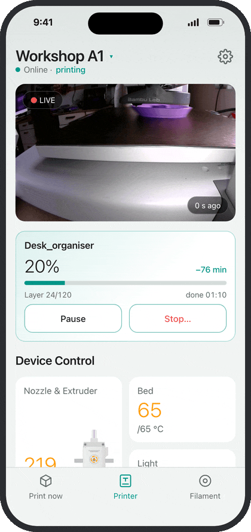

<h1 align="center">Pygmy</h1>

<p align="center">
  Your Bambu Lab and Klipper printers on your phone, <b>without the cloud</b>.<br>
  Live camera, controls, notifications, spaghetti detection and one-tap printing. Everything stays on your network.
</p>

<p align="center">
  
  
  
</p>

<p align="center"></p>

> [!NOTE]
> **Early preview.** Watch the first layers of every print and
> [open an issue](https://github.com/danderik88/pygmy/issues) when something looks off.

## 🚀 Install

Pygmy runs on an always-on computer on the same network as your printers.

**1. Prepare each printer**

- **Bambu Lab:** on the printer screen turn on **LAN-only mode** and **Developer Mode** (Settings, Network), and put a
  **USB stick or SD card (FAT32)** in it. Note the **access code** shown there.
- **Klipper:** nothing to do.

**2. Install Pygmy.** Pick where it runs:

<details>
<summary><b>Proxmox VE</b>: one command on the host, creates its own container</summary>

In the Proxmox web UI open the host's **Shell** and paste:

```sh
bash -c "$(curl -fsSL https://raw.githubusercontent.com/danderik88/pygmy/main/proxmox.sh)"
```

It creates a Debian container (2 cores, 4 GB RAM, 16 GB disk) that starts with the host, installs Docker and Pygmy in
it, and prints the link. Update: `pct exec <id> -- bash -c 'cd /opt/pygmy && git pull && ./install.sh'`

</details>

<details>
<summary><b>Any Linux</b>: mini PC, VM, Raspberry Pi (Debian, Ubuntu...)</summary>

```sh
sudo apt install -y git curl                     # Debian / Ubuntu
curl -fsSL https://get.docker.com | sudo sh      # skip if Docker is already installed
git clone https://github.com/danderik88/pygmy
cd pygmy && sudo ./install.sh
```

It prints the link at the end. Update: `cd pygmy && git pull && sudo ./install.sh`.

</details>

> [!IMPORTANT]
> **Raspberry Pi and other ARM computers: no Print now.** OrcaSlicer has no Linux ARM build, so Pygmy cannot slice
> there. Everything else works. To print from the app, use an x86 computer (an Intel N100 mini PC costs about the same).

The first install takes about 5 minutes: it also downloads OrcaSlicer, which Print now uses to slice, so there is nothing else to install. Tested from scratch on Proxmox VE 9, Debian 13, Ubuntu 25.04 and Debian 13
arm64. Docker Desktop (Mac, Windows) is not tested: use a Linux VM there.

**3. Open the link on your phone**, tap **+ Add printer** and pick your printer. Bambu Lab asks for the access code.

**4. Add it to the home screen** (Share, Add to Home Screen). Try **Print now** with a small STL.

> [!WARNING]
> Developer Mode turns off the printer's cloud login. Keep Pygmy on your home network and **never open its port to
> the internet**. For access from outside use Tailscale (see below).

## 👀 What it does

<table>
<tr>
<td align="center" width="33%"><br><b>Print now</b><br><sub>STL, 3MF, STEP or a Printables link. Sliced on your server, starts after your OK.</sub></td>
<td align="center" width="33%"><br><b>Add a printer</b><br><sub>Found on your network. Pick it, type the code, done.</sub></td>
<td align="center" width="33%"><br><b>Pause on spaghetti</b><br><sub>Watches the camera, pauses once and sends you a photo.</sub></td>
</tr>
<tr>
<td align="center"><br><b>Klipper too</b><br><sub>Any Moonraker printer: motion, lights, sensors, Print now.</sub></td>
<td align="center"><br><b>Several files, one plate</b><br><sub>A Printables page with many parts goes on one plate.</sub></td>
<td align="center"><br><b>AMS drying</b><br><sub>Start and stop drying (P2S, H2 with AMS 2 Pro).</sub></td>
</tr>
</table>

Also: a queue per printer, sliced files that wait under **Ready to print** until you print or remove them, Web Push and Telegram notifications with a photo, Home Assistant (entities and cameras), and an MCP server for AI agents.

**Tested on** A1, A1 mini, P1P, P1S, P2S (H2D: status, pause, stop), with AMS, AMS 2 Pro, AMS lite and BMCU.

## 🔧 More

<details>
<summary><b>Problems</b></summary>

Run these in the `pygmy` folder (on Proxmox: `pct enter <id>`, then `cd /opt/pygmy`).

- **Logs:** `docker compose logs -f app`
- **Wrong address in the link:** `rm .env && ./install.sh 192.168.1.50` (your computer's IP).
- **Printer not in the list:** use **Enter IP** under **+ Add printer**.
- Your data lives in the `pygmy-data` Docker volume and survives updates.

</details>

<details>
<summary><b>Access from outside and notifications</b> (Tailscale)</summary>

[Tailscale](https://tailscale.com) (free) is a private network between your own devices. With it your phone reaches
Pygmy from anywhere, with no router settings, and notifications work (they need an `https` address).

1. **Run one command** where Pygmy is installed.
   - Proxmox, in the Proxmox shell (copy it as it is: it finds the container called `pygmy` by itself):
     ```sh
     pct exec $(pct list | awk '/pygmy/ {print $1}') -- /opt/pygmy/tailscale.sh
     ```
   - Any Linux, in the Pygmy folder: `sudo ./tailscale.sh`
2. **Sign in** when it shows a link: open it on any device and use your Tailscale account (create one for free if
   needed). If a second link asks to switch on HTTPS, open it and press the button.
3. **On each phone:** install the Tailscale app, sign in with the same account and leave it on. Then open the link the
   command printed at the end: it pairs the phone.

That `https` address never changes and works the same at home and away, so use it everywhere (keep Tailscale on).
Your home link (`http://<home address>:8765`) keeps working too, as a backup, and so do the devices you paired
with it. A device is paired once per link.

On a phone already paired at home: Settings, Secure address, Switch pairs it with the `https` address in one tap.
No link to copy, and the home link keeps working.

</details>

<details>
<summary><b>Spaghetti detection</b></summary>

Built in on x86_64: the `ml_api` container (Obico's open-source detector, built unmodified from their repository)
looks at a camera frame every 10 s during each print. A warning sends a notification; a failure pauses the print
once if **Pause on spaghetti** is on for that printer (Options on the printer page, on by default). Pygmy never
resumes a print by itself. Not on ARM.

`PYGMY_OBICO_SENSITIVITY=low|medium|high` in `.env` (default medium). To test without a real failure: put a spaghetti
photo at `<state dir>/spaghetti/test-<printer alias>.jpg` during a print; Pygmy uses it until you delete it.

</details>

<details>
<summary><b>Home Assistant</b> (entities and cameras)</summary>

**Entities, over MQTT.** Put your Mosquitto broker in `.env` (`PYGMY_HA_MQTT_HOST`, `PYGMY_HA_MQTT_PORT`,
`PYGMY_HA_MQTT_USER`, `PYGMY_HA_MQTT_PASSWORD`; create a login for Pygmy in the Mosquitto add-on) and run
`./install.sh` again. Home Assistant finds everything by itself (MQTT discovery under `homeassistant`). Entities are
named `<type>.pygmy_<printer>_<name>` (for example `sensor.pygmy_a1_progress`) and `sensor.pygmy_ams_<serial>_*` for
each AMS. They cover state, progress, temperatures, the file, errors, spools, lights, the pause, resume and stop
buttons, and the last photo of a print.

**Cameras, over RTSP.** Add a Generic Camera per printer with the stream source `rtsp://<pygmy address>:8554/<printer>`
and the user and password shown (hidden, copyable) in the app under Settings, Home Assistant. Printers that send JPEG
(A1, A1 mini, P1P, P1S, Klipper webcams) are converted to H.264 by go2rtc with a keyframe every 2 seconds, so a client
joining a running stream gets a picture within a few seconds.

</details>

<details>
<summary><b>Klipper details and your OrcaSlicer profiles</b></summary>

Pygmy uses Moonraker's documented API. Print now slices from the printer's own `printer.cfg`: the machine always
comes from the printer, there is no printer profile to choose. Pick the loaded filament in the printer's Filament
tab. An ACE Pro shows up as a spool unit.

</details>

<details>
<summary><b>Your OrcaSlicer profiles (Orca Cloud)</b></summary>

Orca Cloud is an **account** setting, not a printer setting: it brings your own filaments and print profiles to
every printer, Bambu included. The machine always comes from the printer itself (Klipper: its `printer.cfg`; Bambu:
the Bambu profiles), so you never choose a printer profile.

**Sign in once** (about two minutes, on a computer or a phone):

1. In Pygmy: **Settings** (the gear icon, top right), **Orca Cloud**, **Open**. Wait up to a minute while Pygmy gets
   the sign-in ready.
2. Press **Continue with Google** (or Apple, or GitHub: use the one you use for OrcaSlicer), then **Open sign-in
   page**. Your browser opens the OrcaSlicer sign-in. Sign in as usual.
3. At the end your browser says it **cannot connect to "localhost"**. That is expected, it is not an error. The
   address in the address bar is the key: copy the **whole address** (it starts with `http://localhost:` and is long).
   On an iPhone the bar shows only a short name: tap it first, then select all and copy.
4. Back in Pygmy, paste it in the box and press **Finish**.

**With an email and password:** press **Continue with email**, type them and press **Sign in**. Nothing to open or
copy. Unlike Google, Apple and GitHub, here your password goes to your own Pygmy once, which types it into OrcaSlicer;
it is not saved or logged.

**After signing in**, your filaments show up at the top of the Filament list under **My Orca profiles**, for every
printer, Bambu included. Pick them like any other filament. If your brand or model is not listed, use Generic (on
Bambu, the matching Bambu profile). Your print profiles (process) are chosen in **Print now**, **Custom**, **Print
profile**.

Profiles update on their own, within about 10 minutes. If nothing arrives, in OrcaSlicer on your computer the user
profile sync must be on, and your profiles must show the cloud icon.

**Signed in with the wrong account, or want to leave?** In the same **Orca Cloud** sheet, press **Sign out of Orca
Cloud**. Pygmy forgets the sign-in; your printers stop following your profiles until you sign in again.

**Why these steps:** Orca Cloud only allows signing in through its own login page, and only from OrcaSlicer itself.
So Pygmy runs OrcaSlicer in the background, opens its login for you and you finish it in your own browser, where you
are already signed in. With Google, Apple or GitHub your password and the sign-in token never reach Pygmy.

**Without an Orca account** (Klipper only): in OrcaSlicer on your computer, **File**, **Export**, **Export Preset
Bundle**, then upload that file in **Printers**, **Orca profiles**. You redo the upload when you change a profile.

</details>

<details>
<summary><b>AI agents</b> (Claude Code or any MCP client)</summary>

The agent slices with an OrcaSlicer MCP server and hands the file to Pygmy, which shows the plate photo and starts only
after your OK. One token per agent: add `,agent=<48-char token>` to `PYGMY_MCP_TOKENS` in `.env`, then `./install.sh`.

```sh
claude mcp add --transport http pygmy http://<pygmy-ip>:8765/ --header "Authorization: Bearer <token>"
```

</details>

<details>
<summary><b>Moving the axes</b> (Expert mode)</summary>

Gear icon, **Advanced**, **Expert mode**, and `PYGMY_MCP_CONTROL=1` in `.env`. Only on the tested models. The printer
does not report the head position, so home first, clear the bed, stay next to it, and **never drive a P1 to X0 Y0**:
the head hits the filament cutter.

</details>

<details>
<summary><b>Without Docker</b></summary>

- Proxmox: systemd units in `deploy/`, `deploy/slicer/provision.sh` creates the slicer LXC.
- No root: `deploy/user/install.sh user@host` (systemd `--user`, OrcaSlicer flatpak, needs Tailscale and `uv`).

</details>

<details>
<summary><b>MakerWorld (limited)</b></summary>

MakerWorld downloads need a sign-in through a non-public account API, which Pygmy does not use. Download the model on
MakerWorld in your own browser and pick it with **Upload** in Print now.

</details>

<details>
<summary><b>Uninstall and clean up</b></summary>

Your printers are not changed by Pygmy: they keep working with their own app, Bambu Handy or Mainsail as before.

**Proxmox** (the container is called `pygmy`): check with `pct list` that only one container has that name, then in
the Proxmox shell:

```sh
N=$(pct list | awk '/pygmy/ {print $1}'); pct stop $N && pct destroy $N --purge
```

That removes everything, including the saved data.

**Any Linux:**

```sh
cd /opt/pygmy            # or wherever you cloned it
docker compose down -v --rmi all
cd .. && rm -rf pygmy
```

`-v` deletes the saved data (printers, devices, your Orca sign-in); leave it out to keep it for a reinstall.

**Leftovers on other devices:**
- Tailscale: remove the `pygmy` machine in the admin console. If you used remote access, also run `tailscale serve reset` first.
- Phones: delete the Pygmy icon from the home screen. Notifications stop once the server is gone.
- Home Assistant: remove the MQTT entities starting with `pygmy_` (the MQTT integration, Devices).
- Orca Cloud: your account is not touched, and the sign-in on this server disappears with it. Without removing Pygmy, use Settings, Orca Cloud, Sign out.

</details>

## 🙏 Thanks

- [OrcaSlicer](https://github.com/SoftFever/OrcaSlicer) (AGPL-3.0): Pygmy runs its unmodified command line and official
  profiles in a separate container; no OrcaSlicer code is copied.
- [go2rtc](https://github.com/AlexxIT/go2rtc) for the camera streams.
- [OpenBambuAPI](https://github.com/Doridian/OpenBambuAPI) and the community that documented the LAN interfaces.
- [tommasobbianchi](https://github.com/tommasobbianchi) for the Klipper backend, SV08 slicing and the rootless installer.
- [tlabcustomaudio](https://github.com/tlabcustomaudio) for H2D support, and the beta testers.

If Pygmy saved you a trip to the printer, you can [buy me a coffee](https://paypal.me/merighidaniel).
Contributing: tests with `python3 -m unittest discover -s tests`; only documented LAN interfaces.

## ⚖️ Disclaimer and license

Pygmy is independent and **not affiliated with Bambu Lab**. Printer names are trademarks of their owners, used only to
say which printers work. It uses only what the printers offer in LAN-only / Developer Mode (MQTT, FTPS, camera).

**Use at your own risk.** A printer heats up and moves: never leave a remote print completely unwatched. Provided as
is, without warranty. MIT license, see `LICENSE`.
